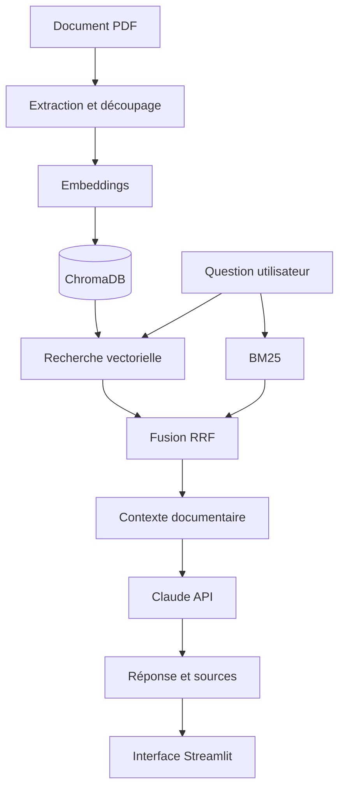

# 🩺 MediQuery — Assistant médical RAG

Testez l'assistant : [ici](https://mediquery-75188976532.europe-west1.run.app/)

**MediQuery** est un assistant conversationnel médical qui exploite le *Retrieval-Augmented Generation (RAG)* pour répondre à des questions en français à partir de documents médicaux.

Le projet met l'accent sur la recherche hybride, la traçabilité des sources, la réduction des hallucinations et la maîtrise des coûts d'utilisation d'un LLM.

> ⚠️ Projet expérimental à visée pédagogique. Il ne remplace pas un professionnel de santé et ne doit pas être utilisé pour établir un diagnostic ou décider d'un traitement.

## ✨ Fonctionnalités

- 💬 Questions en langage naturel sur des documents médicaux.
- 🔎 Recherche hybride combinant BM25 et recherche vectorielle.
- 🧠 Embeddings multilingues avec Sentence Transformers.
- 📚 Indexation et recherche documentaire avec ChromaDB.
- 🤖 Génération de réponses contextualisées via l'API Claude.
- 📖 Affichage des références documentaires disponibles.
- 🛡️ Gestion des situations où le contexte est insuffisant.
- 💰 Limitation du contexte et des tokens générés pour maîtriser les coûts.

## 🏗️ Architecture



## 🧰 Stack technique

| Domaine | Technologies |
|---|---|
| Langage | Python |
| Interface | Streamlit |
| LLM | Claude API — Anthropic |
| Framework RAG | LangChain |
| Embeddings | Sentence Transformers |
| Base vectorielle | ChromaDB |
| Recherche lexicale | BM25 |
| Fusion des résultats | Reciprocal Rank Fusion (RRF) |
| Tests et qualité | Pytest, Ruff |

## 📄 Corpus documentaire

Le prototype s'appuie notamment sur le guide de la Haute Autorité de santé consacré au parcours de soins de l'adulte vivant avec un diabète de type 2.

[Consulter le guide officiel de la HAS](https://www.has-sante.fr/upload/docs/application/pdf/2025-07/parcours_de_soins_du_patient_adulte_vivant_avec_un_diabete_de_type_2_-_guide_2025-07-15_16-42-8_797.pdf)

## 🚀 Installation rapide

Prérequis : Python 3.12 et une clé API Anthropic valide.

```bash
git clone <URL_DE_TON_DEPOT>
cd MediQuery-RAG-Assistant

python -m venv .venv
```

Sous Windows PowerShell :

```powershell
.\.venv\Scripts\Activate.ps1
```

Installer les dépendances et configurer les variables d'environnement :

```bash
pip install -r requirements.txt
```

Créer un fichier `.env` à partir de `.env.example`, puis renseigner notamment `ANTHROPIC_API_KEY`.

Lancer l'application :

```bash
streamlit run app.py
```

Si l'index documentaire n'existe pas encore, suivre les instructions d'ingestion du projet avant de lancer les requêtes.

## 🧪 Tests

```bash
pytest -q
ruff check .
```

Une première évaluation exploratoire a comparé la recherche hybride avec et sans reranking. La stratégie hybride sans reranking a été retenue comme compromis opérationnel sur le jeu de cinq questions utilisé. Ces résultats restent indicatifs et ne constituent pas un benchmark représentatif.

## 💰 Maîtrise des coûts

- Limitation du nombre de passages transmis au LLM.
- Contrôle de la taille des réponses.
- Absence de transmission systématique de l'historique conversationnel.
- Réutilisation de l'index documentaire existant.

## 📚 Documentation

Pour les détails sur les choix techniques, l'évaluation, les limites et la méthodologie, consulter la **[note méthodologique](docs/note_methodologique.md)** si elle est publiée dans le dépôt.

## 👨‍💻 Auteur

**Sambou Diao** — Data Scientist | GenAI | RAG & Agents IA

- LinkedIn : [lien](https://www.linkedin.com/in/sambou-diao-a93443185/)
- GitHub : [lien](https://github.com/Samou19/)

---

*Prototype pédagogique non validé cliniquement. Les réponses doivent être vérifiées auprès de sources médicales fiables et de professionnels de santé.*
