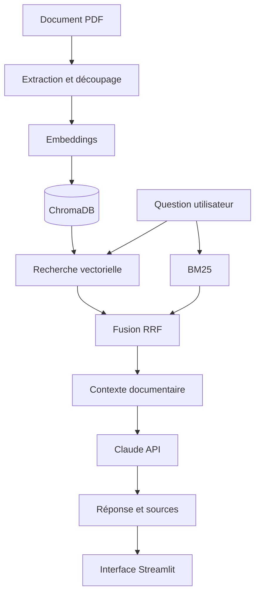

# 🩺 MediQuery — Assistant médical RAG

**Testez l'assistant :** [MediQuery en ligne](https://mediquery-75188976532.europe-west1.run.app/)

MediQuery est un assistant conversationnel médical qui exploite le **Retrieval-Augmented Generation (RAG)** pour répondre à des questions en français à partir de documents médicaux.

Le projet met l'accent sur la recherche hybride, la traçabilité des sources, la réduction des hallucinations et la maîtrise des coûts d'utilisation d'un grand modèle de langage (LLM).

> ⚠️ **Avertissement médical :** projet expérimental à visée pédagogique. MediQuery ne remplace pas un professionnel de santé et ne doit pas être utilisé pour établir un diagnostic ou décider d'un traitement.

## ✨ Fonctionnalités

- 💬 Questions en langage naturel sur des documents médicaux.
- 🔎 Recherche hybride combinant BM25 et recherche vectorielle.
- 🧠 Embeddings multilingues avec Sentence Transformers.
- 📚 Indexation et recherche documentaire avec ChromaDB.
- 🤖 Génération de réponses contextualisées via l'API Claude d'Anthropic.
- 📖 Affichage des références documentaires disponibles.
- 🛡️ Gestion des situations où le contexte récupéré est insuffisant.
- 💰 Limitation du contexte transmis et du nombre de tokens générés pour maîtriser les coûts.

## 🏗️ Architecture



La recherche hybride combine deux approches complémentaires :

- **Recherche vectorielle** : retrouve des passages selon leur proximité sémantique avec la question.
- **BM25** : recherche des correspondances lexicales entre la question et les documents.
- **Reciprocal Rank Fusion (RRF)** : fusionne les classements issus des deux méthodes pour constituer le contexte transmis au modèle génératif.

## 🧰 Stack technique

| Domaine | Technologies |
|---|---|
| Langage | Python 3.12 |
| Interface | Streamlit |
| Modèle génératif | Claude API — Anthropic |
| Framework RAG | LangChain |
| Embeddings | Sentence Transformers |
| Base vectorielle | ChromaDB |
| Recherche lexicale | BM25 |
| Fusion des résultats | Reciprocal Rank Fusion (RRF) |
| Tests et qualité du code | Pytest, Ruff |
| Conteneurisation | Docker |
| CI/CD | GitHub Actions |
| Registre d'images | GitHub Container Registry (GHCR) |
| Hébergement | Google Cloud Run |

## 📄 Corpus documentaire

Le prototype s'appuie notamment sur le guide de la Haute Autorité de santé consacré au parcours de soins de l'adulte vivant avec un diabète de type 2.

📘 [Consulter le guide officiel de la HAS (PDF)](https://www.has-sante.fr/upload/docs/application/pdf/2025-07/parcours_de_soins_du_patient_adulte_vivant_avec_un_diabete_de_type_2_-_guide_2025-07-15_16-42-8_797.pdf)

La pertinence des réponses dépend notamment de la couverture documentaire, de la qualité des passages récupérés et de la capacité du modèle à respecter le contexte fourni.

## 🚀 Installation locale

### Prérequis

- Python 3.12
- Git
- Une clé API Anthropic valide

### 1. Cloner le dépôt

```bash
git clone https://github.com/Samou19/MediQuery-RAG-Assistant.git
cd MediQuery-RAG-Assistant
```

### 2. Créer et activer un environnement virtuel

Sous Windows PowerShell :

```powershell
python -m venv .venv
.\.venv\Scripts\Activate.ps1
```

Sous Linux ou macOS :

```bash
python3 -m venv .venv
source .venv/bin/activate
```

### 3. Installer les dépendances

```bash
python -m pip install --upgrade pip
pip install -r requirements.txt
```

### 4. Configurer les variables d'environnement

Créer un fichier `.env` à partir du modèle `.env.example` :

```powershell
Copy-Item .env.example .env
```

Renseigner ensuite la clé API et les paramètres nécessaires, par exemple :

```dotenv
ANTHROPIC_API_KEY=your_anthropic_api_key
CLAUDE_MODEL=claude-haiku-4-5-20251001
EMBEDDING_MODEL=sentence-transformers/paraphrase-multilingual-MiniLM-L12-v2
```

Les noms des variables doivent correspondre à ceux effectivement pris en charge par la configuration du projet.

**Important :** ne jamais publier le fichier `.env`, une clé API ou d'autres secrets dans le dépôt Git.

### 5. Préparer l'index documentaire

MediQuery utilise une collection ChromaDB nommée `medical_docs`, stockée dans le répertoire `chroma_db/`.

L'index doit être disponible avant de lancer les requêtes. S'il n'est pas fourni avec le projet, exécuter le script d'ingestion prévu dans le dépôt afin de créer l'index à partir des documents autorisés.

### 6. Lancer l'application

```bash
streamlit run app.py
```

Ouvrir ensuite l'adresse locale indiquée par Streamlit, généralement :

[http://localhost:8501](http://localhost:8501)

## 🐳 Lancement avec Docker

Construire l'image :

```bash
docker build -t mediquery-rag-assistant:latest .
```

Lancer le conteneur sous Windows PowerShell :

```powershell
docker run --rm -p 127.0.0.1:8501:8501 --env-file .env mediquery-rag-assistant:latest
```

Puis ouvrir [http://localhost:8501](http://localhost:8501).

L'index ChromaDB doit être présent dans l'image ou fourni séparément au conteneur. La collection `medical_docs` doit être accessible depuis le chemin configuré pour l'application.

## 🧪 Tests et évaluation

Lancer les tests automatisés :

```bash
pytest -q
```

Vérifier la qualité du code :

```bash
ruff check .
```

Une première évaluation exploratoire a comparé la recherche hybride avec et sans reranking. Sur le jeu de cinq questions utilisé, la stratégie hybride sans reranking a été retenue comme compromis opérationnel.

Ces résultats restent **indicatifs** : le nombre de questions est limité et ne constitue pas un benchmark représentatif de la qualité globale du système.

Les dimensions à évaluer comprennent notamment :

- la pertinence des passages récupérés ;
- la fidélité des réponses au contexte documentaire ;
- la pertinence des réponses par rapport aux questions ;
- la capacité à reconnaître les questions auxquelles le corpus ne permet pas de répondre ;
- la latence et le coût des appels au modèle génératif.

## 💰 Maîtrise des coûts

Plusieurs choix contribuent à limiter les coûts d'inférence :

- Limitation du nombre de passages transmis au modèle.
- Contrôle du nombre maximal de tokens générés.
- Absence de transmission systématique de l'historique conversationnel.
- Réutilisation de l'index documentaire existant, sans réindexation à chaque question.

Les coûts réels dépendent notamment du volume de requêtes, de la taille des contextes, de l'utilisation de l'API Anthropic et des ressources consommées sur Google Cloud.

## 🚀 CI/CD et déploiement

Le projet s'appuie sur Docker et GitHub Actions pour automatiser les étapes de validation et de construction de l'image. L'image est publiée sur GitHub Container Registry, puis utilisée pour le déploiement sur Google Cloud Run.

Image publiée :

```text
ghcr.io/samou19/mediquery-rag-assistant:latest
```

La clé API Anthropic doit être injectée au moment de l'exécution via un mécanisme de gestion des secrets, tel que Google Cloud Secret Manager, et non intégrée à l'image.

## 📚 Documentation

Pour approfondir les choix techniques, la méthodologie et les résultats de l'évaluation, consulter la note méthodologique si elle est effectivement disponible dans le dépôt :

`docs/Note_methodologique_MediQuery.docx`

## 🔭 Pistes d'amélioration

- Élargir le jeu de questions de référence et renforcer l'évaluation quantitative.
- Comparer différentes stratégies de chunking et de retrieval.
- Améliorer la présentation des sources et la traçabilité des réponses.
- Mesurer la latence et les coûts dans des conditions d'utilisation variées.
- Renforcer la gestion des erreurs et la supervision de l'application.
- Étudier les mécanismes de protection contre les questions hors périmètre et les réponses non étayées.

## 👨‍💻 Auteur

**Sambou Diao** — Data Scientist | GenAI | RAG & Agents IA

- LinkedIn : [Sambou Diao](https://www.linkedin.com/in/sambou-diao-a93443185/)
- GitHub : [Samou19](https://github.com/Samou19/)

---

*Prototype pédagogique non validé cliniquement. Les réponses doivent être vérifiées auprès de sources médicales fiables et de professionnels de santé.*
